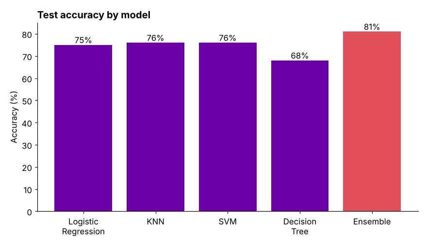
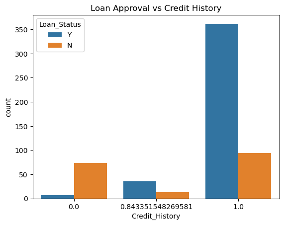
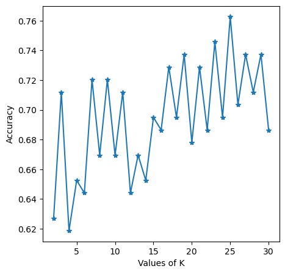

# LoanLens: Loan Approval Prediction

Predicting whether a loan application will be approved from the applicant's financial and demographic details, and comparing which machine learning models do it best.



## Data

`LoanApprovalPrediction.csv`: about 600 loan applications with 12 features:

- **Applicant:** gender, marital status, dependents, education, self-employment
- **Finances:** applicant income, co-applicant income, loan amount, loan term, **credit history**
- **Property:** property area (urban, semi-urban, rural)
- **Target:** `Loan_Status` (approved or not)

## Approach

1. **Exploratory analysis:** distributions, income vs loan amount, and approval rates by feature.
2. **Preprocessing:** filled missing values, encoded the categorical features and scaled the numerical ones.
3. **Class balance:** about two thirds of applications are approved, so the training set was balanced with **SMOTE**.
4. **Model comparison** on a held-out 20% test set:
   - Logistic regression with six different solvers
   - KNN, testing every K from 2 to 30
   - SVM with four kernels, plus a grid search over C and gamma
   - Decision tree
   - Ensembles: bagging, random forest, voting, AdaBoost, gradient boosting and XGBoost

## Results

| Model family | Best test accuracy |
|---|---|
| **Ensembles** (random forest, gradient boosting, XGBoost) | **81%** |
| KNN (K = 25) | 76% |
| SVM | 76% |
| Logistic regression | 75% |
| Decision tree | 68% |

- **Ensembles performed best** at 81%. A single decision tree overfit and did worst.
- **Credit history is by far the strongest signal.** Applicants with a good credit history were approved in most cases; those without were mostly rejected.
- **Choosing K mattered for KNN:** accuracy ranged from 62% to 76% depending on K.

| Approval by credit history | KNN accuracy for each K |
|---|---|
|  |  |

## Repository

| File | What it is |
|---|---|
| `LoanApprovalPrediction.ipynb` | The full analysis |
| `LoanApprovalPrediction (1).html` | The notebook exported as HTML |
| `LoanApprovalPrediction.csv` | The dataset |
| `figures/` | Charts used in this README |

[View the notebook with all outputs on nbviewer](https://nbviewer.org/github/tisyavaidya/Loan-Approval-Prediction-Model/blob/main/LoanApprovalPrediction.ipynb)

## Run it yourself

```bash
git clone https://github.com/tisyavaidya/Loan-Approval-Prediction-Model.git
cd Loan-Approval-Prediction-Model
pip install pandas numpy scikit-learn imbalanced-learn xgboost matplotlib seaborn jupyter
jupyter notebook LoanApprovalPrediction.ipynb
```

## Tools

Python, pandas, NumPy, scikit-learn, imbalanced-learn (SMOTE), XGBoost, Matplotlib, Seaborn

---

[Tisya Vaidya](https://tisyavaidya.com) · [LinkedIn](https://www.linkedin.com/in/tisya-vaidya/) · [GitHub](https://github.com/tisyavaidya)
